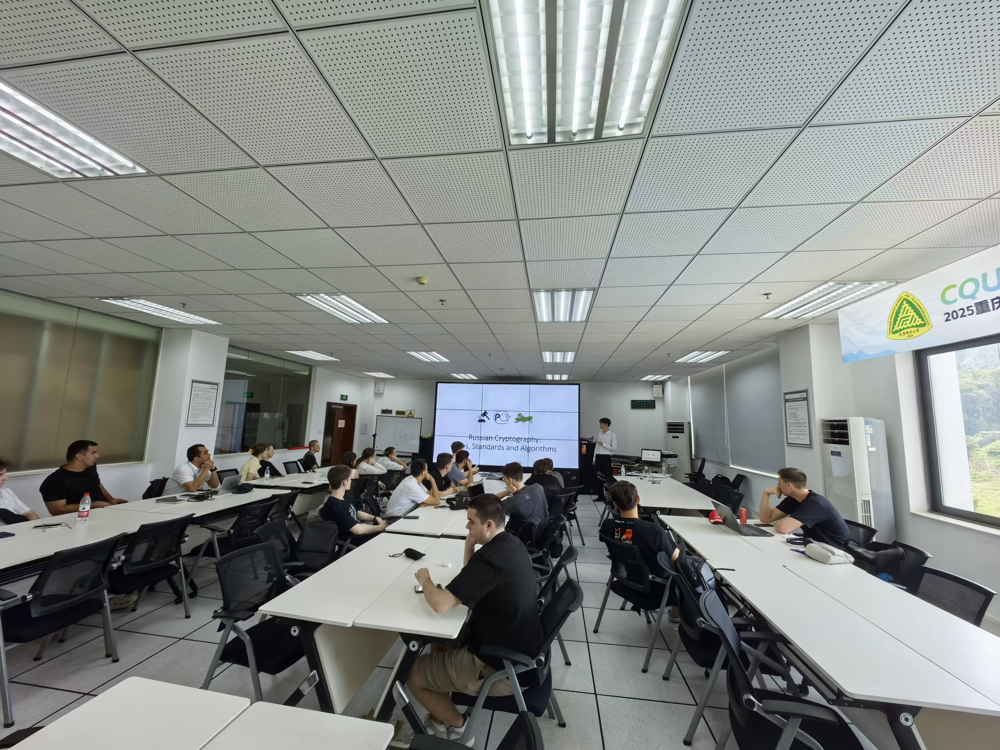
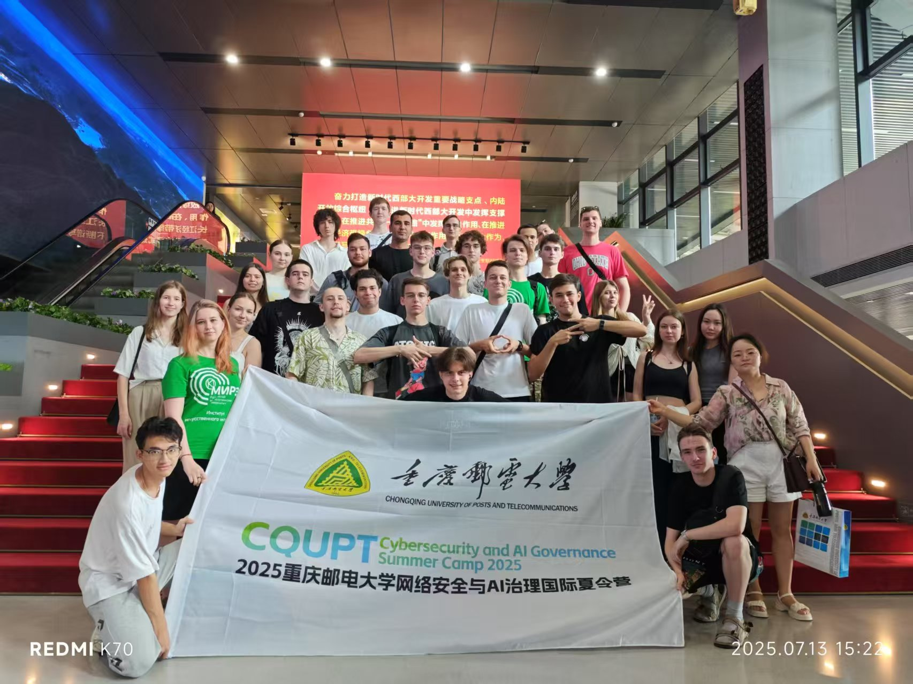

# Public talks

[Home](./) · [PIR Notes](./pir-schemes) · [Public talks](./public-talks)

<strong>Featured LinkedIn post</strong>

<iframe
  src="https://www.linkedin.com/embed/feed/update/urn:li:ugcPost:7523267807296499712"
  height="900"
  width="504"
  style="display: block; max-width: 100%; margin: 0 auto;"
  frameborder="0"
  allowfullscreen=""
  loading="lazy"
  title="Embedded LinkedIn post">
</iframe>

[Open this post on LinkedIn](https://www.linkedin.com/feed/update/urn:li:ugcPost:7523267807296499712)

<strong>CQUPT Cybersecurity and AI Governance Summer Camp 2025 — _July 2025_</strong>

Presented Russia's cryptography laws, national standards, and algorithms to an international student audience at CQUPT.

[Slides](/files/public_talks/cqupt_summercamp25/russian_cryptography.pptx) · [CQUPT event report](https://sl.cqupt.edu.cn/info/1041/14396.htm) · [News coverage](https://cq.cri.cn/2025-07-14/2f43fc47-d728-435b-b07b-a38d282d9b10.html)

*Presenting Russian cryptography to summer-camp participants at CQUPT.*

*CQUPT Cybersecurity and AI Governance Summer Camp 2025 participants.*

