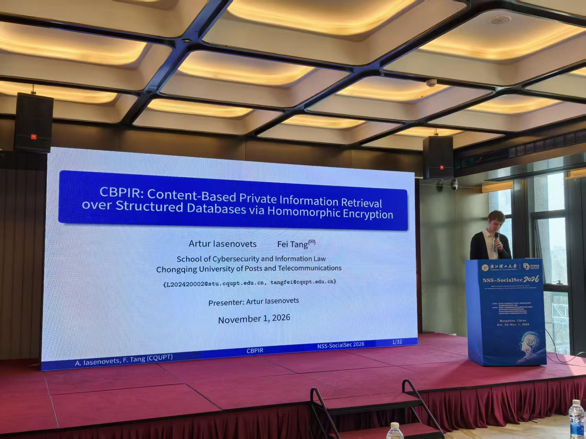
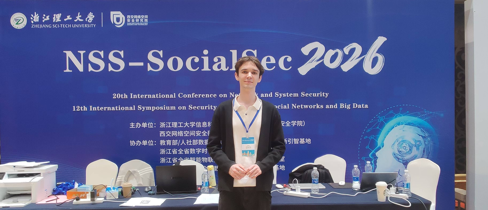

# Public talks

[Home](./) · [PIR Notes](./pir-schemes) · [Public talks](./public-talks)

<strong>NSS-SocialSec 2026 — _November 2026_</strong>

Presented our paper, “CBPIR: Content-Based Private Information Retrieval over Structured Databases via Homomorphic Encryption,” in Hangzhou on 1 November 2026.

The paper explores the substring-PIR direction suggested by Feer: in some systems, a client may not know the index of the record containing a text pattern of interest. We extend this idea to retrieve an associated payload for a matching record. Each record is a tuple of an identifier, searchable text, and payload; for example, the searchable text could be document metadata and the payload a PDF.

[Conference](https://lnkd.in/dgTz-rjs) · [Feer's work](https://lnkd.in/dgeHtYhV) · [LinkedIn post](https://www.linkedin.com/feed/update/urn:li:ugcPost:7523267807296499712)

*Presenting CBPIR at NSS-SocialSec 2026 in Hangzhou.*

*NSS-SocialSec 2026 in Hangzhou.*

<strong>CQUPT Cybersecurity and AI Governance Summer Camp 2025 — _July 2025_</strong>

Presented Russia's cryptography laws, national standards, and algorithms to an international student audience at CQUPT.

[Slides](/files/public_talks/cqupt_summercamp25/russian_cryptography.pptx) · [CQUPT event report](https://sl.cqupt.edu.cn/info/1041/14396.htm) · [News coverage](https://cq.cri.cn/2025-07-14/2f43fc47-d728-435b-b07b-a38d282d9b10.html)

*Presenting Russian cryptography to summer-camp participants at CQUPT.*

*CQUPT Cybersecurity and AI Governance Summer Camp 2025 participants.*

